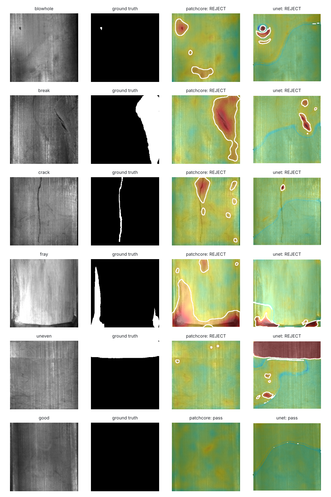
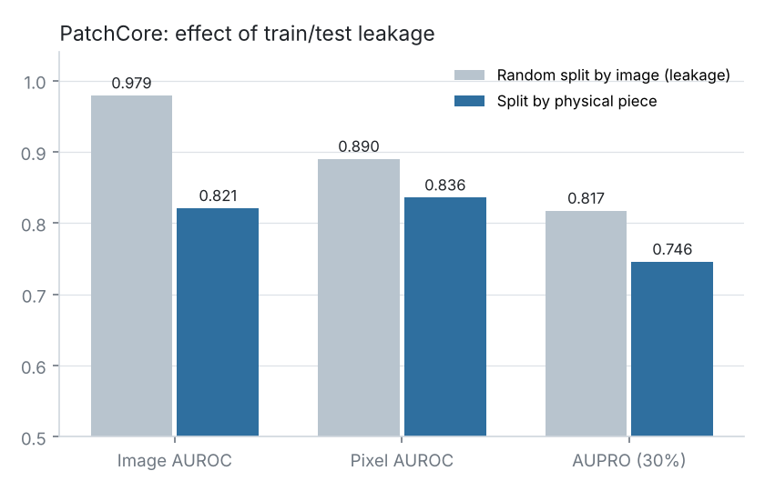
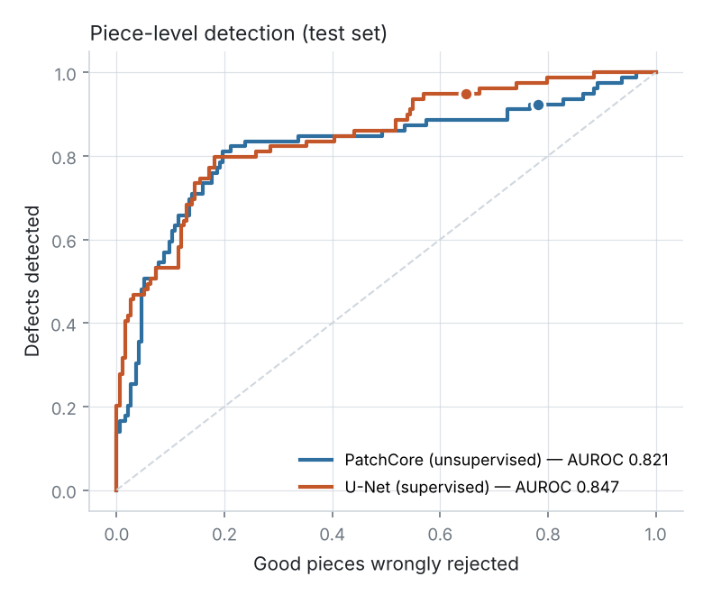

# DefectVision

**Visual inspection of industrial parts: detect, localise and classify surface defects, then serve the model on CPU.**


DefectVision compares the two approaches a factory actually has to choose between, on a **real public dataset**
([Magnetic Tile Defects](https://github.com/abin24/Magnetic-tile-defect-datasets.), Huang et al.:
1,344 grayscale images, pixel-level masks, 5 defect types):

- **PatchCore** (unsupervised, implemented from scratch): trained on **good parts only**. No defect has to be
  collected or annotated, which matters because defects are rare on a production line.
- **U-Net** (supervised): learns from pixel masks to segment each defect and name its type.

Both models are exported to **self-contained ONNX files** (memory bank, decision threshold and metadata included)
and served by a **FastAPI** service with a small web UI, in a Docker image that ships **ONNX Runtime only, no PyTorch**.



## The finding that matters: data leakage

Each physical tile was photographed under **6 lighting conditions**. A random split by image puts the same
physical piece in both train and test, and the model gets credit for recognising a piece it has already seen.
I regrouped the images by physical piece (consecutive IDs, one image per lighting condition; the masks of a group
overlap, those of different groups don't) and **split by piece**.



Same PatchCore model, same code: a random split reports an image AUROC of **0.979**; the honest split gives
**0.821**. Most published numbers on this dataset use per-image splits. All results below use the per-piece split
(148 pieces for training, 49 for validation, 49 for test), and confidence intervals are computed by bootstrapping
**pieces**, not correlated images.

## Results (test set: 49 unseen pieces, 272 images)

| | PatchCore (unsupervised) | U-Net (supervised) |
|---|---|---|
| Defect labels used for training | **0** | 232 images with masks |
| Image AUROC (95% CI) | 0.821 (0.652–0.957) | **0.847** (0.713–0.932) |
| Pixel AUROC | 0.836 | **0.924** |
| AUPRO (FPR ≤ 30%) | **0.746** | 0.637 |
| Recall at the chosen threshold | 92.4% | 94.9% |
| Good parts wrongly rejected at that threshold | 78.2% | 64.8% |
| Training time (2 vCPU, no GPU) | 4 min | 24 min (12 epochs) |
| ONNX Runtime latency, p50 / p95 | 102 / 120 ms | 69 / 74 ms |
| Model file | 29 MB | 57 MB |



**Operating point.** The decision threshold is chosen on the validation pieces to catch at least 95% of defects
(an escaped defect costs more than a re-inspection), then frozen and measured on the test pieces.

**Honest reading.**
- Neither model is ready to run unattended. At 95% recall, both reject most good parts, so they would work as a
  **pre-filter** for a human inspector, not as a replacement.
- PatchCore reaches 0.82 AUROC **without a single defect label**, close to the supervised model. It is strong on
  cracks, blowholes and fray (0.91–1.00) but weak on breaks at the tile edges (0.61).
- The U-Net localises defects better pixel by pixel (pixel AUROC 0.92) and is near-perfect on the large *uneven*
  defects (IoU 0.86). It struggles on small defects and on naming the defect type (32% accuracy). It was trained
  for only 12 epochs on CPU, and its validation scores were still improving (`reports/unet_history.json`).
- The next steps would be more epochs or a GPU, higher resolution for small defects, and per-class thresholds.

Full metrics, including per-defect AUROC, IoU and the confusion matrix, are in [`reports/`](reports/).

## Engineering details

| Topic | What was done |
|---|---|
| Pretrained weights without a model hub | ImageNet ResNet-18 from the ONNX Model Zoo (SHA-256 pinned), converted node by node into the torchvision architecture. Output parity with ONNX Runtime: max difference 4e-6 (tested) |
| PatchCore | Layer 2 + 3 features with 3×3 local averaging, greedy k-centre coreset (2% of 587,776 patches) on a random projection, nearest-neighbour distance, Gaussian smoothing. Distance computed as a matrix-vector product: about 9× faster coreset selection (measured) |
| U-Net | ResNet-18 encoder, 6-class output (good + 5 defect types), cross-entropy + Dice loss, flips and lighting augmentation, balanced sampling of good parts |
| Metrics | Image and pixel AUROC (Mann-Whitney, tested against scikit-learn), AUPRO up to 30% FPR, operating point, bootstrap CIs by piece |
| Export | One ONNX file per model: the whole pipeline (features, kNN against the memory bank, upsampling, blur) is in the graph. Threshold and model type are stored in ONNX metadata. PyTorch vs ONNX Runtime difference < 3e-6 |
| Serving | FastAPI `POST /inspect` returns decision, score, defect type, defective area and a heat-map overlay. Prometheus metrics, 10 MB upload limit, input validation |
| Tests | 17 tests on synthetic textures with drawn scratches: grouping and leakage-free splits, metrics, coreset, PatchCore detection, ONNX parity, API |
| CI | Lint + tests with PyTorch CPU; the committed models are loaded with ONNX Runtime only; Docker build and smoke test |

## Run it

```bash
# Inference only (ONNX Runtime, the models are in models/)
pip install .
dv serve                        # http://localhost:8000 (web UI) and /docs (API)
# or
docker build -t defectvision . && docker run -p 8000:8000 defectvision

curl -F "file=@web/samples/crack_exp3_num_249637.jpg" "localhost:8000/inspect?model=unet&heatmap=false"
```

Reproduce the experiments (CPU is enough):

```bash
pip install torch torchvision --index-url https://download.pytorch.org/whl/cpu
pip install -e ".[train,dev]"
dv fetch-data && dv fetch-weights
dv patchcore                    # ~5 min
dv patchcore --random-split     # leakage experiment
dv unet                         # ~25 min
dv export && dv benchmark && dv figures
pytest
```

All settings (seed, split fractions, model hyper-parameters, target recall) are in `configs/default.yaml`.

## Project structure

```
src/defectvision/
  data.py         dataset download (pinned commit), grouping by physical piece, splits, preprocessing
  backbone.py     ONNX Model Zoo -> torchvision ResNet-18 weight conversion
  patchcore.py    PatchCore: features, coreset, kNN scoring, anomaly map
  segmentation.py U-Net, losses, augmentation, training loop
  metrics.py      AUROC, AUPRO, operating point, bootstrap
  experiments.py  reproducible runs -> JSON reports
  export.py       ONNX export + parity check;  release.py  export of all models, CPU benchmark
  inference.py    production inference (ONNX Runtime + OpenCV, no PyTorch)
  api.py          FastAPI service;  report.py  figures
web/              demo UI and sample test images
models/           shipped ONNX models
reports/          metrics (JSON) and figures
```

## Data and licence

Dataset: Y. Huang, C. Qiu, K. Yuan, "Surface defect saliency of magnetic tile", *The Visual Computer*, 2020
([repository](https://github.com/abin24/Magnetic-tile-defect-datasets.)). It is downloaded at a pinned commit and
not redistributed, except for the 6 sample images in `web/samples/`, which are from that dataset.

Code: MIT, Mohamed Anas Ben Mim.
